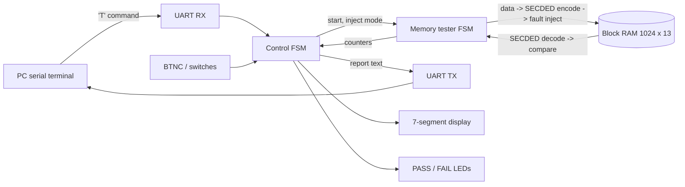

# FPGA Memory Tester with SECDED ECC

A hardware memory test engine written in VHDL for the Digilent Nexys4 DDR (Xilinx Artix-7). It runs standard memory test patterns across on-chip block RAM, protects every word with Hamming SECDED error-correcting code, and injects faults on demand to prove the ECC corrects single-bit errors and detects double-bit errors. It is controlled and reports results over a UART link to a PC.

## Architecture



## Features

- **Six test patterns:** all zeros, all ones, checkerboard, inverse checkerboard, address-in-address, and walking ones, each targeting a different class of memory fault (stuck-at bits, coupling between neighboring bits, address decoder faults).
- **SECDED ECC:** 8 data bits are stored as a 13-bit codeword (Hamming(12,8) plus an overall parity bit). Single-bit errors are located by the syndrome and corrected; double-bit errors are flagged as uncorrectable.
- **Fault injection:** SW0 flips 1 bit, SW1 flips 2 bits, in every 64th word. The flipped position rotates through all 13 codeword bits.
- **Silent corruption check:** any word whose data is wrong *without* an error flag is counted separately as `BAD`, which is the failure mode ECC exists to prevent.
- **UART command interface** at 115200 baud, a 7-segment readout, and status LEDs.

## Usage

1. Program the board and open a serial terminal at 115200 baud, 8N1.
2. Set the switches (both off = no injection, SW0 = 1-bit, SW1 = 2-bit).
3. Press `T` in the terminal or press BTNC.

Example output with SW0 on:

```
RESULT=PASS MODE=S INJ=0060 COR=0060 UNC=0000 BAD=0000 CYC=00004800
```

All counters are hexadecimal: 0x60 = 96 faults injected, all 96 corrected.

## Verification

| Testbench | What it checks | Result |
|---|---|---|
| `tb_secded` | Every data value × no error, all 13 single-bit errors, all 78 double-bit errors | 23,552 / 23,552 cases pass |
| `tb_mem_tester` | Full test in all three injection modes; counters match expected | Pass |
| `tb_uart_echo` | UART RX/TX with back-to-back bytes | Pass |
| `tb_memtest_top` | End to end: sends `T` over simulated UART, parses the report | Pass |

## Results

| Metric | Value |
|---|---|
| Clock | 100 MHz |
| Words verified per run | 6,144 (1,024 words × 6 patterns) |
| Test time | 18,432 cycles = 184 µs |
| LUTs / FFs / BRAM used | *fill in from Vivado utilization report* |
| Worst negative slack | *fill in from Vivado timing report* |

## Files

- `src/` design sources (`memtest_top.vhd` is the top level)
- `sim/` self-checking testbenches
- `constraints/memtest_nexys4ddr.xdc` pin constraints
- `src/uart_echo_top.vhd`, `sim/tb_uart_echo.vhd`, `constraints/phase1_uart_echo.xdc` UART bring-up design used during development
